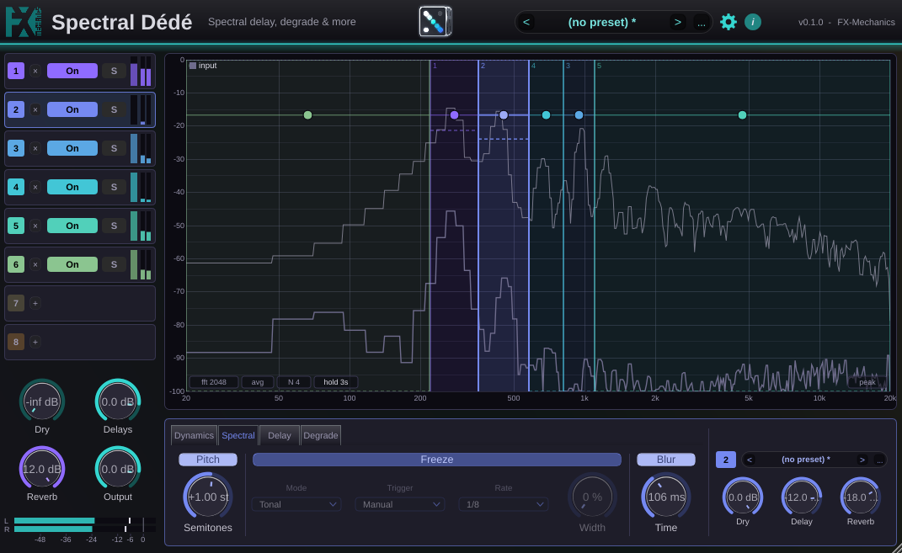
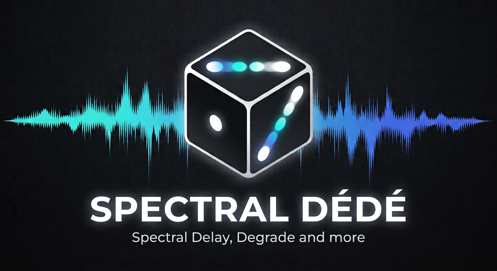

# Spectral Dédé

A spectral multi-delay, degrader and reverb, by FX-Mechanics. VST3, AU and
standalone, for Linux, Windows and macOS.



Spectral Dédé (Dede for short) shows you the spectrum of the incoming signal
and lets you draw rectangles on it. Each rectangle is a a frequency
band, cut out of the input and sent through its own small channel strip:
dynamics, spectral effects, a stereo delay, a degrade chain, and a send to a
shared reverb. Up to eight regions run at once, each with its own settings.

A region is a set of FFT bins, and its height on the view
means something: the bottom edge is a gate, the top edge a ceiling. A region
drawn high over a band keeps only the peaks that rise into it (the notes of a
melody, say), and one drawn low keeps only what lies under them (the noise,
the room, the breath). So two regions over the same frequencies can send a
sound's tonal part to a long ping-pong delay and its noise floor to the
reverb, each processed on its own.

## Key concepts

### Regions

A region has two frequency borders (its left and right edges) and three
horizontal lines:

| Line | Look | What it does |
|---|---|---|
| Gate | dashed, lower | Below it, a bin is turned down: a hard gate by default, or a gentler expander. At the bottom of the view, the gate is off. |
| Ceiling | dotted, upper | Above it, a bin is cut by default, or compressed or limited. At the top of the view, the ceiling is off. |
| Gain | solid, with a round handle | Its height is the region's gain; the handle, dragged sideways, is its pan. |

The gate and ceiling are compared with each bin's level, and the spectrum
trace is measured the same way the gates measure (same window, same scale,
peak detection, no averaging). Where the trace crosses a gate line on screen,
those bins pass. What you see is what passes.

### The region strip

Each region processes its band in this order:

```
        ┌──────────────────────── global Dry (untouched input) ──────────────────────┐
        │                                                                            │
 in ──> band ──> dynamics ──> spectral ──> degrade ──> pan ─┬──> region Dry ─────────┼──> out
               (gate/ceiling) (pitch,     (before)          │                        │
                              freeze,                       └──> delay ──> degrade ──┤
                              blur)                     degrade (in loop) ↺  (after) │
                                                                                     │
                       region Dry + Delay ──> reverb send ──> shared reverb ─────────┘
```

- **Dynamics**: what the gate and ceiling lines do. Under the gate, a
  downward expander (ratio, range, knee, attack, release); over the ceiling,
  a compressor, a limiter or a cut. In the Spectral engine this works on each
  bin separately, a spectral expander/compressor; in the Live engine, on the
  whole band.
- **Spectral**: pitch shift (in semitones), freeze and blur, done inside the
  FFT frame, with no extra latency.
- **Degrade**: saturation, bit-crush, downsample, transpose and frequency
  shift. Each stage has its own position (see below).
- **Pan**, then two outputs at their own levels: the region's **Dry** (its
  band, undelayed) and its **Delay** (its repeats).
- **Reverb send**, taken after the Dry and Delay levels, like a post-fader
  send.

The global **Dry** is the untouched input, all frequencies, never processed.
Regions add on top of it; they do not replace their band in it. To hear only
what the regions do, turn the global Dry down.

### Degrade positions

Every degrade stage can run in one of three places:

- **Before** the delay: on the band itself. The region's Dry hears it too.
- **In loop**: inside the delay's feedback loop. The first echo goes through
  the stage once, the second twice, and so on. A saturator drives each repeat
  harder, Transpose +12 climbs an octave per repeat (the shimmer effect), and
  Freq shift makes the repeats spiral up or down (a barber-pole effect).
- **After** the delay: on the repeats only.

### Delay-time modes

Each region's left and right times are read one of three ways:

- **Seconds**.
- **DAW sync**: a fraction of a whole note at the host tempo (0.25 is a
  quarter note, 0.1875 a dotted sixteenth).
- **MIDI note**: a multiple of the period of the last MIDI note received. A
  short delay with high feedback becomes a resonator tuned to whatever is
  played. This is why the plugin takes MIDI input although it is an audio
  effect: route a MIDI track to it in your DAW.

Feedback is set per side, plus a cross feedback (left into right and back,
for ping-pong). At its minimum, feedback is silence, so a delay with no
feedback gives exactly one repeat. The delay scales its feedback down by
itself whenever the settings would make it run away, so it never
self-oscillates. Delays go up to 6 seconds.

### Two engines: Spectral and Live

Set in the global controls. Spectral is the default and the reason for the
plugin; Live is there for when latency matters more, or if you want it to
wotk more like a classical multiband effect. In this mode, you can indeed
use it like a multiband compressor if needed.

| | Spectral | Live |
|---|---|---|
| How bands are cut | FFT bins, near brick-wall edges | filters, 24 dB per octave |
| Gate and ceiling | per bin: keep only the peaks, or only the floor | per band: the whole band opens or closes |
| Spectral tab (pitch, freeze, blur) | yes | no effect |
| Transients | softened a little by the window | intact |
| Latency | one FFT window (2048 samples, 43 ms at 48 kHz, by default) | none |

In Live, the view also shows each region's band level as a shaded column, as
it is that level, not the trace, that the gate compares.

### Latency and FFT size

The Spectral engine delays the signal by one FFT window. The plugin reports
this to the host, which compensates for it, and the global Dry is delayed by
the same amount so everything stays in step. The window is set in the global
controls, from 1024 to 16384 points. Larger windows give finer regions and
cleaner gating; smaller ones keep transients sharper and cut the latency.
Changing it causes a short dropout; some hosts pick up the new latency only
when the transport stops.

### Stereo

With **Stereo** bands (the default) each region keeps the input's left and
right. Gating decisions are still taken on their sum, the mono signal the
view shows, and applied to both sides. **Mono** bands sum the input first and
use half the CPU. For stereo bands the **pan law** decides what panning does:
**Balance** turns down the side the region moves away from; **Stereo pan**
folds that side into the other, so nothing is lost.

### On, Solo, and deleting a region

- **On** acts at the region's input: off, nothing new enters it, but its
  delay and reverb tails ring out.
- **Solo** acts at the output: every region not soloed is silenced (the
  global Dry stays).
- **×** deletes the region and frees its slot. A region drawn in that slot
  later starts clean, with no leftover tail.

## Using it

### Layout

- **Top bar**: the preset bar, the gear (global controls), and the **i**
  (in-app help). Clicking the logo shows the splash screen.
- **Region column** (left): one row per slot, with its number, **×** or
  **+**, On, Solo and two meters (how much of the band the gate lets through,
  and the region's output level). Click a row to select its region.
- **Levels** (under the column): global Dry, Delays (all regions' repeats),
  Reverb (the shared reverb's return) and Output, then the output meter.
- **Spectrum view**: the input spectrum and the regions drawn over it.
- **Region dock** (under the spectrum): the selected region's settings. Tabs
  on the left (Dynamics, Spectral, Delay, Degrade); on the right, always in
  view, the region's preset bar and its output knobs (Dry, Delay, Reverb).
  The dock stays open while you drag the region's lines, so you can watch the
  knobs move.

### Mouse and keyboard

| Action | Gesture |
|---|---|
| Draw a region | drag on empty space |
| Draw a region over others | shift+drag anywhere, or **+** on a free row |
| Move a border | drag it (it sticks to neighbouring borders, so regions meet exactly) |
| Move a whole region | drag inside it |
| Copy a region | ctrl+drag it, then drop the copy |
| Set gate, ceiling, gain | drag the line up or down |
| Set pan | drag the round handle left or right |
| Reset a line or the pan | double-click it (gate and ceiling go back to off) |
| Delete the selected region | Delete or Backspace |
| Zoom the level axis | mouse wheel |
| Zoom the frequency axis | ctrl+wheel |
| Pan the view | alt+drag or middle-drag |
| Reset the view | double-click on empty space |
| Type a knob's value | right-click it |

Hover help is on every control; the **?** in the global controls turns it on
and off.

### The region dock

**Dynamics**: Gate and Ceiling switches (they follow the lines: switching one
off parks its line at the end of its range, switching it back on restores
it), and for each line its ratio, knee, attack and release; the gate also has
a range (how far down it goes).

**Spectral**: Pitch (semitones, fractional). Freeze, in Tonal mode (held
notes stay notes) or Wash (a smooth static texture), triggered by hand or by
the host tempo: **Retrigger** captures again at each step, **On/off** freezes
one step and lets the next through. Freeze **Width** spreads the frozen left
and right apart (stereo bands only). Blur smears the band over time, a tail
confined to the band. This tab has no effect in the Live engine.

**Delay**: the time mode, left and right times, left, right and cross
feedback. Its switch follows the region's Delay level.

**Degrade**: saturation (four models, with a drive that changes the tone, not
the level), bit-crush, downsample, transpose and freq shift, each with its own
switch and position.

A new region starts as a slight synced echo with a little reverb, so you hear
it as soon as it is drawn.

### Global controls

The gear opens the settings you set once rather than play: the reverb's room
size, damping and width; the engine (Spectral or Live); stereo or mono bands;
the pan law; the FFT size; and the hover help switch.

### Presets

There are two levels of presets:

- **Global presets**, in the top bar, recall everything, regions included.
  The factory set covers the main uses: Three Bands, Ping Pong Highs, Gated
  Wash, Tuned Strings, Drum Splitter, Freeze Pad, Barber Pole, and more. User
  presets are saved under `FX-Mechanics/SpectralDede/Presets` in your user
  data folder (`~/.config` on Linux, `~/Library/Application Support` on
  macOS, `%APPDATA%` on Windows).
- **Region presets**, in the region dock, recall everything about one region
  except its frequency range. A region preset saved from one region shows up
  in every region, in every instance of the plugin. The factory set includes
  echoes (Slap Back, Dotted Echo, Tape Echo), freezes, a shimmer climb, a
  barber pole and a MIDI-tuned resonator. User region presets go to
  `FX-Mechanics/Modules/SpectralRegion/Presets`.

Presets and host sessions save the FFT size and engine too, so they also
recall the latency.

### A few starting points

- **Echo only the melody**: draw a region over the melody's range and raise
  its gate until only the peaks of the trace cross it. Turn its Delay up.
- **Reverb on the noise only**: draw a region over the same range with its
  ceiling just under the peaks and its gate off. Turn its Dry and Delay down
  and its Reverb send up.
- **Tuned resonator**: set a region's time mode to MIDI note, times of 1 and
  2, feedback high, and play notes into the plugin's MIDI input.
- **Shimmer**: put Transpose in the loop at +12 and give the delay some
  feedback.

## Building

JUCE is expected as a sibling directory of this repo. FxmeTools is a submodule
and carries WDL as its own nested submodule, so clone recursively.

```sh
git submodule update --init --recursive
cmake -B build -DCMAKE_BUILD_TYPE=Release
cmake --build build -j2 --target SpectralDede_VST3
```

Formats built are VST3, AU (macOS) and a standalone application. The design
is described in [doc/architecture.md](doc/architecture.md).

Releases are cut by pushing a version tag (`git tag v0.1.0 && git push
--tags`), which builds and publishes Linux, Windows and a macOS universal
binary. The same workflow can be run by hand from the Actions tab to test the
builds without publishing anything.

The factory presets in `Source/Assets` are generated, not hand-written:

```sh
DEDE_ASSETS=Source/Assets python3 tools/make_presets.py
```

## Installing

The build does not install anything. Copy the built bundle into the plugin
folder and let the DAW rescan (it caches the module, so a reload is usually
needed too).

### macOS

These plugins are not notarised, so a downloaded bundle is quarantined and the
DAW silently skips it. Clear the flag after copying it in place:

```sh
xattr -dr com.apple.quarantine "/Library/Audio/Plug-Ins/VST3/SpectralDede.vst3"
```

## Licence

Spectral Dédé follows the licence of the FxmeTools JUCE module it is built
on, which mirrors JUCE 8's own dual licence:

    SPDX-License-Identifier: AGPL-3.0-or-later OR LicenseRef-FXME-Commercial

- **AGPLv3 or later** (full text in [LICENSE](LICENSE)): use, modify and
  redistribute it, provided what you distribute is also released under the
  AGPLv3 with its complete source. This pairs with using JUCE under its
  AGPLv3 option.
- **Commercial terms** from the author, for those who hold a commercial JUCE
  licence and do not want to release under the AGPL. Contact via
  [github.com/odoare](https://github.com/odoare) or www.fx-mechanics.com. A
  commercial grant covers this code only; JUCE has to be licensed separately
  from Raw Material Software.

The submodules keep their own terms: FxmeTools' `core/` is LGPL-3.0-or-later,
its JUCE module is under the same dual licence as this plugin, and WDL
(Cockos) is under the zlib licence. See `lib/FxmeTools/LICENSE.md`.


